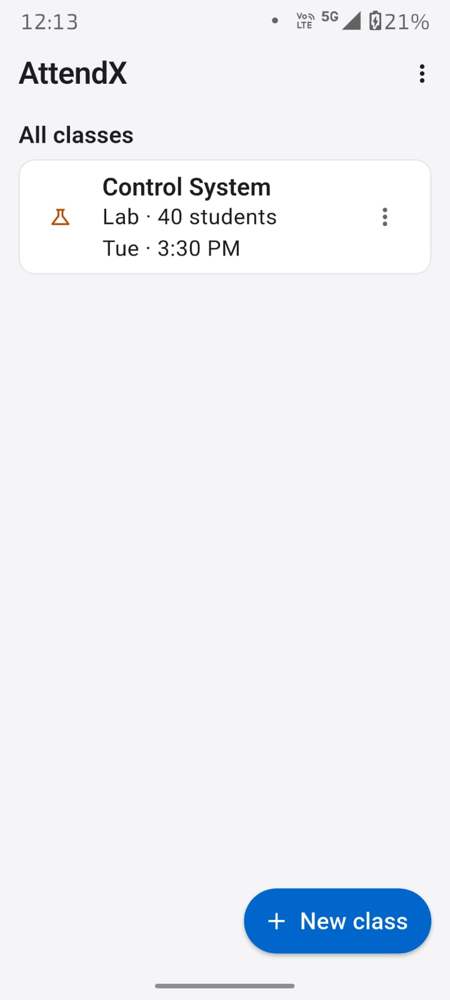
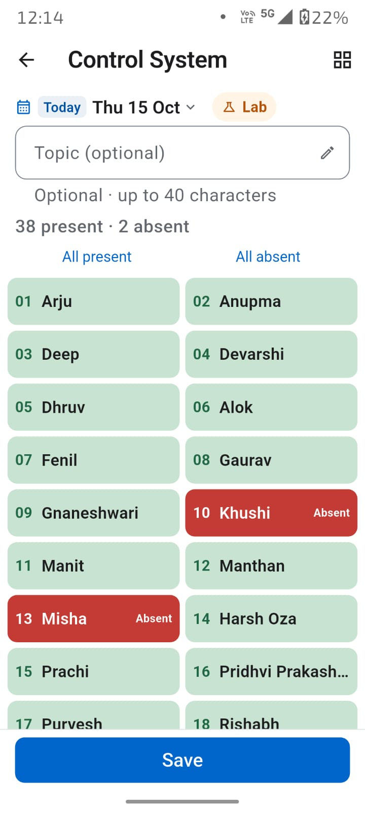
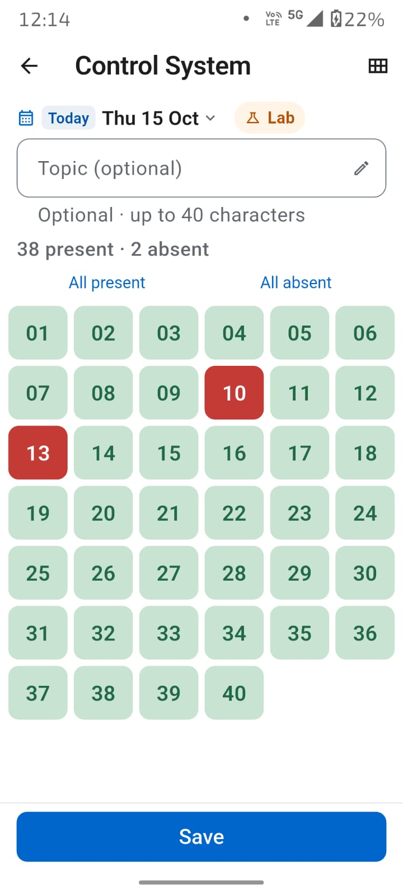
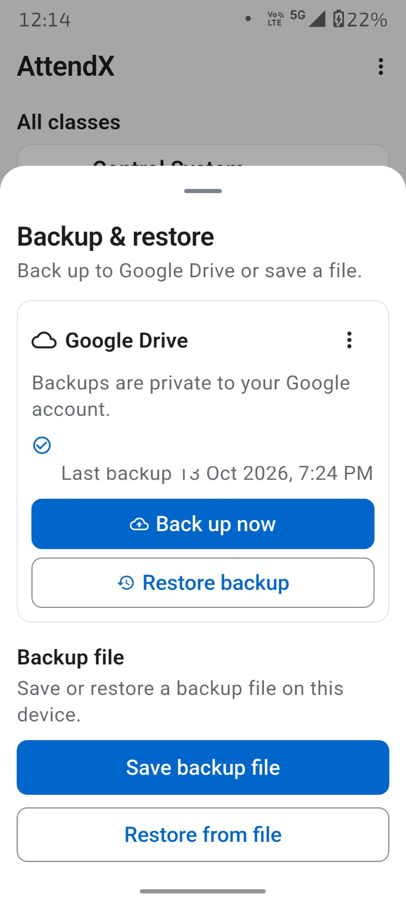

# AttendX

[](https://github.com/dd-joshi/AttendX/releases)
[](LICENSE)
[](https://developer.android.com/about/versions)
[](https://flutter.dev)
[](https://dart.dev)
[](PRIVACY.md)

**[📥 Download Latest APK](https://github.com/dd-joshi/AttendX/releases/latest)** | **[📋 All Releases](https://github.com/dd-joshi/AttendX/releases)** | **[📖 User Manual](USER_MANUAL.md)** | **[🔒 Privacy Policy](PRIVACY.md)**

---

## Overview

**AttendX** is a **minimal, offline-first attendance app for Android**, built for faculty who need fast, reliable roll-call without accounts, internet, or friction. Designed for real classrooms — large rosters, missed dates, changing enrollments, and the need for portable records that survive reinstalls and phone changes.

> **No login. No cloud (unless you tap). No ads. No analytics. No tracking.**
> All data lives on your device. Google Drive backup is **opt-in, user-tapped only**, stored in your private Drive app-data folder.

### Why AttendX?

| Problem | AttendX Solution |
|---------|------------------|
| Slow roll-call | **Default-present** — tap only absent students |
| Missed a class? | **Backdated entry** — pick any past date |
| New students mid-semester | **Append-only roster** — old attendance preserved |
| Name typo? | **Roll-preserving correction** — fixes propagate to all records |
| Phone broke / app uninstalled | **JSON backup + Google Drive** — one-tap restore |
| Export for admin | **Rich CSV** — topics, percentages, lecture/lab separation |
| Privacy concerns | **Fully offline** — zero network calls unless you choose Drive |

---

## ✨ Key Features

### 🎯 Smart Attendance
- **Default-present cards** — green = present, tap to mark absent (red)
- **Two views**: Two-column roll/name cards **or** compact roll-number grid
- **Long-press preview** — hold a grid cell to see the name above your finger
- **Per-session Topic** — optional 40-char note (what was taught), saved & exported
- **Lecture / Lab types** — separate schedules, badges, CSV columns (`yyyy-MM-dd` vs `yyyy-MM-dd Lab`)
- **Per-weekday start times** — Mon 9 AM, Fri 1 PM, etc.

### 📋 Roster Management
- **Paste names** — one per line, rolls assigned automatically
- **Append-only updates** — later admissions never rewrite history
- **Name correction** — pencil icon or long-press; follows roll through all records
- **No reorder/remove** — roll identity is sacred for data integrity

### 📊 Export & Reporting
- **CSV by class & date range** — share via system sheet (Drive, email, etc.)
- **Rich filename**: `AttendX_Class A_2026-07-10_to_2026-08-09_85pct.csv`
- **Dash (`-`)** = student not in roster for that date
- **Topic row** under each date column
- **Lecture/Lab columns separated** for same date

### 💾 Backup & Restore (Critical!)
> **Uninstalling the app (or installing a differently-signed build) erases local data.**

| Method | Description |
|--------|-------------|
| **JSON file** | One file: all classes, rosters, attendance. Save anywhere (Drive, USB, cloud). Validate on restore. |
| **Google Drive** | Private app-data folder. **User-tapped only**. 5 newest verified copies retained (MD5 + size check). |
| **Android system** | Auto-backup on Android 9+ (encryption-dependent). AttendX cannot verify recency. |
| **Reminders** | Dashboard banner: after 1st change → 1 day/5 changes → snooze 7 days. |

### 🔒 Privacy by Design
- **Zero network requests** unless you tap "Back up to Google Drive"
- **No accounts, no telemetry, no analytics, no ads**
- **Local Hive storage** — encrypted by Android filesystem
- **Full policy**: [PRIVACY.md](PRIVACY.md) | **Cloud setup**: [docs/GOOGLE_DRIVE_SETUP.md](docs/GOOGLE_DRIVE_SETUP.md)

---

## 📱 Screenshots

<!-- Add screenshots here when available -->
| Dashboard | Attendance (Cards) | Attendance (Grid) | Backup & Restore |
|:---------:|:------------------:|:-----------------:|:----------------:|
|  |  |  |  |
| *Class list with backup reminder* | *Two-column roll/name* | *Compact number grid* | *JSON + Drive options* |

> **Want to contribute screenshots?** See [Contributing](#-contributing).

---

## 🚀 Quick Start

### Install (End Users)
1. Go to **[Releases](https://github.com/dd-joshi/AttendX/releases/latest)**
2. Download `AttendX-<version>.apk`
3. Install on Android 7+ (enable "Install unknown apps" if prompted)
4. Open → **+ New class** → start taking attendance

### Build from Source (Developers)

#### Prerequisites
- Flutter SDK **≥ 3.47.5** (Dart ≥ 3.13)
- Android Studio / VS Code with Flutter plugin
- Android SDK **API 24+** (Android 7.0 Nougat)

#### Steps
```bash
# Clone
cd h:/joshi.ele/AttendX-main  # or your preferred path

# Get dependencies
flutter pub get

# Generate Hive adapters (after model changes)
flutter pub run build_runner build --delete-conflicting-outputs

# Analyze & test
flutter analyze
flutter test

# Run on device/emulator
flutter run

# Build release APK
flutter build apk --release
# Output: build/app/outputs/flutter-apk/app-release.apk
```

> **Note**: After model/native changes, use **Stop + Run** (not just Hot Reload).

---

## 🏗 Architecture & Tech Stack

```
lib/
├── main.dart                 # App entry, providers, routing
├── core/                     # Domain models, constants, utils
│   ├── models/               # Class, Student, Attendance, Backup, Topic
│   ├── constants/            # Keys, limits, colors, strings
│   └── utils/                # Date, CSV, JSON, validation helpers
├── data/                     # Repository layer (Hive)
│   ├── boxes/                # Hive box definitions & adapters
│   └── repositories/         # ClassRepo, AttendanceRepo, BackupRepo
├── providers/                # Riverpod state (classes, attendance, prefs)
├── screens/                  # UI screens
│   ├── dashboard/            # Class list, backup banner, menu
│   ├── class_detail/         # Manage class, roster, schedule
│   ├── attendance/           # Date picker, cards/grid, topic, save
│   ├── export/               # CSV export flow
│   ├── backup/               # JSON + Drive backup/restore
│   └── settings/             # About, privacy, licenses
└── widgets/                  # Reusable UI components
    ├── attendance_card.dart  # Student card (present/absent)
    ├── number_grid.dart      # Compact roll grid with long-press
    ├── topic_row.dart        # Editable topic with counter
    └── ...
```

### Core Dependencies
| Package | Purpose |
|---------|---------|
| `flutter_riverpod` | Reactive state management |
| `hive` + `hive_flutter` | Local NoSQL storage (fast, typed) |
| `share_plus` | System share sheet for CSV/JSON |
| `file_picker` | Destination picker for backups |
| `http` + `crypto` | Google Drive API (upload, verify MD5) |
| `uuid` | Stable IDs for classes/students/attendance |
| `intl` | Date formatting, locale support |
| `path_provider` | App documents directory |

---

## 📦 Release Artifacts

| Artifact | Description |
|----------|-------------|
| `AttendX-<version>.apk` | Universal release APK (ARM64 + ARMv7) |
| `AttendX-<version>-compact-restore.apk` | Test build with compact restore flow |
| **Version scheme** | `major.minor.patch+build` (e.g., `1.2.2+5`) |
| **Signing** | Release keystore (not debug) — see `android/key.properties` template |
| **Application ID** | `io.github.ddjoshi.attendx` (Play Store compliant) |

### Verifying a Release
```bash
# Check APK signature
apksigner verify --print-certs AttendX-1.2.2+5.apk

# Check version
./gradlew :app:printVersion  # or inspect AndroidManifest.xml
```

---

## 📚 Documentation

| Document | Purpose |
|----------|---------|
| [USER_MANUAL.md](USER_MANUAL.md) | Complete end-user guide |
| [CHANGELOG.md](CHANGELOG.md) | Version history (semver) |
| [PRIVACY.md](PRIVACY.md) | Privacy policy (offline-first, Drive optional) |
| [docs/GOOGLE_DRIVE_SETUP.md](docs/GOOGLE_DRIVE_SETUP.md) | Cloud Console setup for maintainers |
| [docs/PLAY_RELEASE.md](docs/PLAY_RELEASE.md) | Play Store release checklist |

---

## 🤝 Contributing

Issues and PRs welcome! Please:

1. **Read** [USER_MANUAL.md](USER_MANUAL.md) to understand the product
2. **Run** the checks before committing:
   ```bash
   dart format --output=none --set-exit-if-changed lib test
   flutter analyze
   flutter test
   ```
3. **Follow** conventional commits (`feat:`, `fix:`, `docs:`, `refactor:`, etc.)
4. **Update** `CHANGELOG.md` under `## [Unreleased]` for your changes

### Good First Issues
- Add screenshots to `assets/screenshots/` and update this README
- Improve accessibility labels (semantics) on attendance screens
- Add unit tests for CSV export / backup validation logic
- Translate UI strings (currently English only)

---

## 📄 License

**MIT License** — see [LICENSE](LICENSE) for details.

```
Copyright (c) 2026 dd-joshi

Permission is hereby granted, free of charge, to any person obtaining a copy
of this software and associated documentation files (the "Software"), to deal
in the Software without restriction, including without limitation the rights
to use, copy, modify, merge, publish, distribute, sublicense, and/or sell
copies of the Software...
```

---

## 🙏 Acknowledgments

- **Flutter team** — for an excellent framework
- **Hive** — blazing-fast local storage
- **Riverpod** — pragmatic state management
- **All contributors** — issues, PRs, testing, feedback

---

<div align="center">

**Built with ❤️ for faculty who'd rather teach than track attendance.**

[⭐ Star this repo](https://github.com/dd-joshi/AttendX) • [🐛 Report a bug](https://github.com/dd-joshi/AttendX/issues) • [💡 Request a feature](https://github.com/dd-joshi/AttendX/issues/new)

</div>
